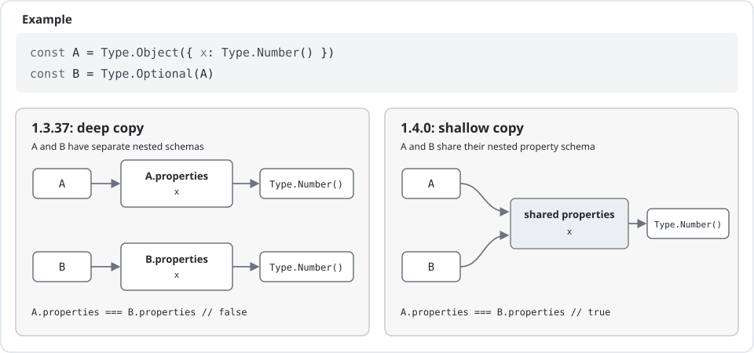

# 1.4.0

---

### Version Updates
- [Revision 1.4.3](https://github.com/sinclairzx81/typebox/pull/1721)
  - Support RFC 9557 Ext Suffix for Date Time 
- [Revision 1.4.2](https://github.com/sinclairzx81/typebox/pull/1719)
  - Ensure Pick and Omit Retain Property Modifiers
- [Revision 1.4.1](https://github.com/sinclairzx81/typebox/pull/1717)
  - Faster FNV1A-64 Hashing [#1713](https://github.com/sinclairzx81/typebox/pull/1713) 

<a name="overview"></a>

## Overview

Revision 1.4.0 improves memory usage and schema initialization performance by composing types with shared JavaScript references rather than recursively cloned subschemas. These updates are made in support of applications that manage hundreds or thousands of schemas, with the aim of improving scalability and application startup performance.

> Revision 1.4.0 is an internal update to TypeBox's memory subsystem that prevents unnecessary deep cloning during type composition. Output schema generation, validation, and type inference remain unchanged. The updates in this revision are expected to be low impact; however, because subschemas are now shared by reference, the switch from cloning to referencing warrants a minor version bump and extended documentation for applications that mutate schemas after creation.

## Contents

- [Overview](#overview)
- [Referential Types](#referential-types)
  - [Example](#example)
  - [Performance](#performance)
  - [Referencing](#referencing)
- [Immutable Types](#immutable-types)
  - [Performance](#performance-1)
  - [Recommendation](#recommendation)

---

<a name="referential-types"></a>

## Referential Types

Revision 1.4.0 composes subschemas by reference when applying type-mapping functions to JSON Schema. In 1.3.0, each schema was deep-cloned during composition, which led to high allocation rates as schema hierarchies grew. Revision 1.4.0 corrects this behavior and reverts to 0.x shallow cloning only.

### Example

The example below marks where cloning occurs when composing objects with nested Optional calls. In 1.3.37, each Optional call deep-cloned its input schema. This led to diminishing performance for deeply nested JSON structures, such as DeepOptional.

```typescript
const FlatOptional = Type.Object({           //    | 1.3.37  | 1.4.0   |
  x: Type.Optional(Type.Number()),           // 1. | depth 1 | depth 1 |
  y: Type.Optional(Type.Number()),           // 2. | depth 1 | depth 1 |
})

const DeepOptional = Type.Object({           //    | 1.3.37  | 1.4.0   |
  nested: Type.Optional(Type.Object({        // 6. | depth 4 | depth 1 |
    nested: Type.Optional(Type.Object({      // 5. | depth 3 | depth 1 |
      nested: Type.Optional(Type.Object({    // 4. | depth 2 | depth 1 |
        nested: Type.Optional(Type.Object({  // 3. | depth 1 | depth 1 |
          x: Type.Optional(Type.Number()),   // 1. | depth 1 | depth 1 |
          y: Type.Optional(Type.Number()),   // 2. | depth 1 | depth 1 |
        }))
      }))
    }))
  }))
})
```

### Performance

With shallow cloning, each mapped type copies only one level of the schema's immediate properties instead of recursively cloning its subschemas. The table shows average construction times across 25,000 constructions of FlatOptional and DeepOptional, comparing TypeBox 1.3.37 with 1.4.0.

| Schema | Iterations | TypeBox 1.3.37 | TypeBox 1.4.0 | Performance |
| :-- | :-- | :-- | :-- | :-- |
| FlatOptional | 25,000 | 113.00 ms | 85.17 ms | 1.33× faster |
| DeepOptional | 25,000 | 1,122.52 ms | 267.76 ms | 4.19× faster |

### Referencing

In 1.4.0, subschemas are shared between a schema and the types composed from it; only the outer schema's immediate properties and keywords are copied. The diagram illustrates the change.

<div>
  
</div>

As shared subschemas follow standard JavaScript reference semantics, the effect is that mutations to a subschema may be observed by other schemas that reference it.

```typescript
import Type from 'typebox'

const A = Type.Object({ x: Type.Number() })
const B = Type.Optional(A)

// Mutate subschema 'x' on A
Object.assign(A.properties.x, { type: 'foo' })
Object.assign(A.properties.x, { description: 'bar' })

// Mutation observed on B
console.log(B)            // B: {
                          //   type: 'object',
                          //   required: [ 'x' ],
                          //   properties: {
                          //     x: {
                          //       type: 'foo',       <-- via A mutation
                          //       description: 'bar' <-- via A mutation
                          //     }
                          //   }
                          // }
```

The above referential model has been used extensively in TypeBox 0.x, and problems arising from shared subschema references were rare to nonexistent. However, applications that mutate 1.x types after creation should take note of this change. In the majority of cases, controlled post-schema mutation is generally going to be fine, but if an application needs to guard against potential mutability issues, enable [Immutable Types](#immutable-types) to cause post-creation mutations to throw at their respective call sites.

---

<a name="immutable-types"></a>

## Immutable Types

Revision 1.4.0 enhances the `immutableTypes` configuration setting to ensure all schemas are recursively deep frozen on creation. This setting safeguards against unintended schema mutation. When enabled, attempts to modify a schema in place throw immediately, helping identify mutation call sites.

```typescript
import System from 'typebox/system'
import Type from 'typebox'

// Ensure all schemas are immutable.
System.Settings.Set({ immutableTypes: true })

const A = Type.Object({ x: Type.Number() })

Object.assign(A.properties.x, { type: 'foo' })
//        ^
// TypeError: Cannot assign to read only property 'type' of object '#<Object>'
```

### Performance

The `immutableTypes` setting adds overhead to type construction comparable to that of TypeBox 1.3.37's default deep cloning during creation. The table compares average construction times with the option disabled and enabled for the FlatOptional and DeepOptional schemas above.

| Schema | Iterations | `immutableTypes` false (default) | `immutableTypes` true | Performance |
| :-- | --: | --: | --: | :-- |
| FlatOptional | 25,000 | 87.77 ms | 199.67 ms | 2.27× slower |
| DeepOptional | 25,000 | 268.70 ms | 1,097.69 ms | 4.09× slower |

### Recommendation

Enable `immutableTypes` during development and testing to confirm schemas aren't modified after composition. Once verified, turn it off in production to skip the freezing cost.